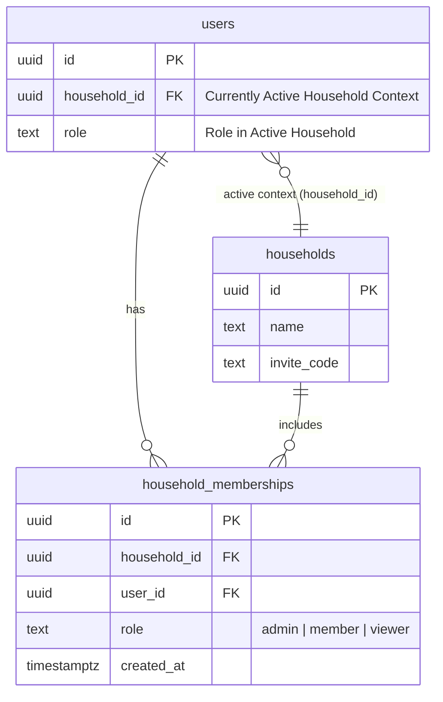
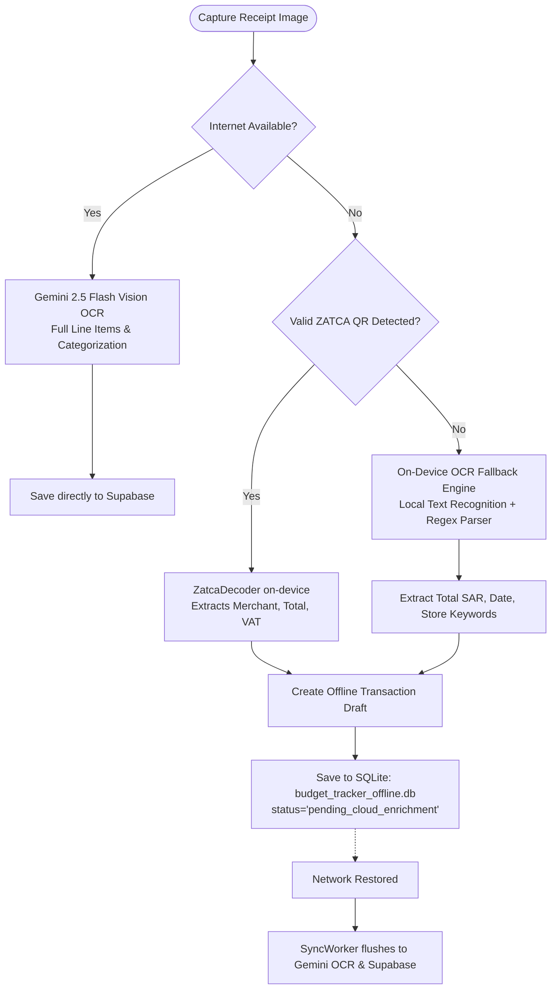
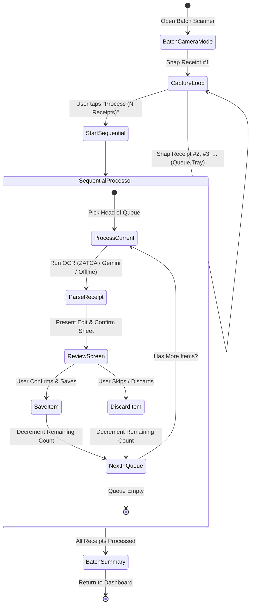

# Design Spec: Multi-Household Switching, On-Device OCR Fallback & Sequential Batch Receipt Scanning

**Date:** 2026-10-18  
**Branch:** `feature/multi-source-income-and-accounts`  
**Status:** In Review  
**Authors:** AI Assistant & Core Engineering Team  

---

## 1. Feature Status Confirmations & Offline Queue Audit

### 1.1 Household & Onboarding Confirmations
| Feature | Implementation Status | Grounding in Codebase |
| :--- | :---: | :--- |
| **Multi-role management** (`Admin`, `Member`, `Dependent`) | **Confirmed & Active** | Supported in `public.users(role, financial_role)` and `public.household_dependents`. Admins manage budgets and members; contributing members view/log; dependents track personal expenses without debt settlement. See [`household_management_card.dart`](file:///c:/Users/A/OneDrive/Python%20projects/budget-tracker/flutter_app/lib/widgets/settings/household_management_card.dart) and [`role_invite_dialog.dart`](file:///c:/Users/A/OneDrive/Python%20projects/budget-tracker/flutter_app/lib/widgets/settings/role_invite_dialog.dart). |
| **Pre-account placeholder member profiles with child allowances** | **Confirmed & Active** | Implemented via `household_dependents` table with `monthly_allowance` (Masroof) column. Managed in [`add_household_member_sheet.dart`](file:///c:/Users/A/OneDrive/Python%20projects/budget-tracker/flutter_app/lib/widgets/settings/add_household_member_sheet.dart) and displayed in SAR/mo with child/elderly avatar icons. |
| **Targeted Claim-on-Join via invite code** | **Confirmed & Active** | Implemented in migration `20261015_manual_members_and_claim_merge.sql`. `household_invites.target_member_id` points to the pre-created dependent. [`HouseholdScreen`](file:///c:/Users/A/OneDrive/Python%20projects/budget-tracker/flutter_app/lib/screens/onboarding/household_screen.dart) previews targeted profiles in `_buildTargetedClaimBanner` and executes `claimMemberProfile` to bind the new auth user to the existing profile history. |

### 1.2 Receipt Scanner & OCR Confirmations
| Feature | Implementation Status | Grounding in Codebase |
| :--- | :---: | :--- |
| **ZATCA Phase 2 Base64 TLV hardware QR camera scanner** | **Confirmed & Active** | Implemented in [`ZatcaQrCameraScanner`](file:///c:/Users/A/OneDrive/Python%20projects/budget-tracker/flutter_app/lib/widgets/zatca_qr_camera_scanner.dart) using `mobile_scanner` with a hardware-accelerated laser viewfinder. Decoded on-device via [`ZatcaDecoder`](file:///c:/Users/A/OneDrive/Python%20projects/budget-tracker/flutter_app/lib/services/zatca_decoder.dart) extracting Tags 1–5 (Seller, VAT #, ISO Timestamp, Total, 15% VAT). |
| **Gemini 2.5 Flash Vision OCR multi-page scanner** | **Confirmed & Active** | Implemented in [`MultiPageReceiptScannerScreen`](file:///c:/Users/A/OneDrive/Python%20projects/budget-tracker/flutter_app/lib/screens/scanner/multi_page_receipt_scanner_screen.dart) and [`receipt_scanner.py`](file:///c:/Users/A/OneDrive/Python%20projects/budget-tracker/ai_service/receipt_scanner.py). Multi-shot captures are stitched vertically via PIL and analyzed using Gemini Flash Vision. |
| **Line-item breakdown extraction & auto-categorization** | **Confirmed & Active** | Prompts Gemini to output complete, un-truncated itemized arrays (`name`, `quantity`, `price` in SAR). Items are automatically classified into Saudi standard codes (`OPEX-GROCERY`, `OPEX-DINING`, etc.) and rendered via [`TransactionItemBreakdownCard`](file:///c:/Users/A/OneDrive/Python%20projects/budget-tracker/flutter_app/lib/widgets/transaction_item_breakdown_card.dart). |
| **Supabase Storage (receipts) with zoomable photo viewer** | **Confirmed & Active** | Handled by [`ReceiptStorageService`](file:///c:/Users/A/OneDrive/Python%20projects/budget-tracker/flutter_app/lib/services/receipt_storage_service.dart) uploading to Supabase Storage `receipts` bucket with strict household RLS paths. Zoomable photo viewer is implemented in [`ReceiptPhotoViewerDialog`](file:///c:/Users/A/OneDrive/Python%20projects/budget-tracker/flutter_app/lib/widgets/receipt_photo_viewer_dialog.dart) utilizing Flutter's `InteractiveViewer` (0.8x to 4.0x zoom and pan). |
| **Duplicate candidate detection & prevention** | **Confirmed & Active** | Handled in [`dedup_engine.py`](file:///c:/Users/A/OneDrive/Python%20projects/budget-tracker/ai_service/dedup_engine.py) via deterministic SHA-256 ZATCA QR fingerprints + fuzzy window matching (±0.05 SAR within 24h). Displays warnings in [`DuplicateCandidateCard`](file:///c:/Users/A/OneDrive/Python%20projects/budget-tracker/flutter_app/lib/widgets/scanner/duplicate_candidate_card.dart). |

### 1.3 Offline SQLite Queue Audit & Cleanup
- **Question:** Do we still have `phone_sms_queue.db`, and do we need it?
- **Finding:** An empty, 0-byte orphan file named `phone_sms_queue.db` was present in the repository root from an obsolete prototype documentation reference.
- **Security Rule Compliance:** Under [.agents/rules/04-security-and-privacy.md](file:///c:/Users/A/OneDrive/Python%20projects/budget-tracker/.agents/rules/04-security-and-privacy.md) (Rule 1: Zero SMS Interception Policy), the application strictly prohibits reading, listening to, or queuing SMS messages.
- **Resolution:**
  1. The 0-byte `phone_sms_queue.db` file in the root directory has been **deleted**.
  2. [`docs/PROJECT_DETAILS.md`](file:///c:/Users/A/OneDrive/Python%20projects/budget-tracker/docs/PROJECT_DETAILS.md) has been updated to correctly document the true offline SQLite engine: `budget_tracker_offline.db` (`offline_sync_queue` table managed by [`OfflineQueueManager`](file:///c:/Users/A/OneDrive/Python%20projects/budget-tracker/flutter_app/lib/services/offline_queue_manager.dart)).

---

## 2. Feature 1: Multi-Household Switching Architecture

### 2.1 Problem & Motivation
Saudi users often manage both their **Personal Flat / Nuclear Family** (e.g. spouse and children) and their **Parents' Home / Shared Family Villa** (e.g. contributing to parents' grocery or utility bills, or managing elder parents' expenses). Currently, `public.users.household_id` is a 1-to-1 foreign key. Joining another household overwrites this column, requiring users to repeatedly re-enter invite codes.

### 2.2 Data Model: Hybrid Junction Pattern
To support belonging to multiple households simultaneously **without rewriting Row Level Security (RLS) across 19 relational tables**:



1. **New Table: `public.household_memberships`**:
   - `id UUID PRIMARY KEY DEFAULT gen_random_uuid()`
   - `household_id UUID NOT NULL REFERENCES public.households(id) ON DELETE CASCADE`
   - `user_id UUID NOT NULL REFERENCES public.users(id) ON DELETE CASCADE`
   - `role TEXT NOT NULL DEFAULT 'member' CHECK (role IN ('admin', 'member'))`
   - `is_default BOOLEAN NOT NULL DEFAULT false`
   - `created_at TIMESTAMPTZ NOT NULL DEFAULT now()`
   - Unique constraint: `UNIQUE(household_id, user_id)`

2. **Active Context Pointer**:
   - `users.household_id` remains the single **active household pointer**.
   - **Why this is critical:** All existing RLS policies (`WHERE household_id IN (SELECT household_id FROM users WHERE id = auth.uid())`) remain 100% valid, performant, and unchanged! Zero regression risks across transactions, budgets, accounts, transfers, debts, and receipts.

3. **Atomic Switching RPC: `switch_active_household(p_household_id UUID)`**:
   - Checks if `auth.uid()` has an entry in `household_memberships` for `p_household_id`.
   - If valid, updates `users.household_id = p_household_id` and sets `users.role = membership.role`.
   - Returns the updated household profile.

4. **Backfill Migration**:
   - Automatically migrates existing `users.household_id` records into `household_memberships` where `user_id = users.id` and `role = users.role`.

### 2.3 Flutter UX: Quick Household Switcher Sheet
- **Entry Points:**
  - In `DashboardScreen` / App Bar: Tapping the current household name chip (e.g. "🏡 Riyadh Flat ▾") opens the `HouseholdSwitchSheet`.
  - In `HouseholdManagementCard` ([`household_management_card.dart`](file:///c:/Users/A/OneDrive/Python%20projects/budget-tracker/flutter_app/lib/widgets/settings/household_management_card.dart)): "Switch Household" button triggers the same sheet.
- **Sheet Features:**
  - Radio list of all associated households showing:
    - Household name
    - Active status indicator (Electric Teal checkmark)
    - Role badge (`Admin` or `Member`)
  - "Join Another Household" button (prompts for 8-char invite code without losing current memberships).
  - "Create New Household" button (creates and links a new household).
- **State Invalidation & Re-hydration:**
  - Upon switching, Flutter calls:
    ```dart
    await apiService.switchHousehold(newHouseholdId);
    context.read<TransactionProvider>().init(newHouseholdId);
    context.read<BudgetProvider>().init(newHouseholdId);
    context.read<AccountService>().loadAccounts(newHouseholdId);
    ```
  - App state instantaneously reloads all transactions, accounts, and budgets for the selected household.

---

## 3. Feature 2: Lightweight On-Device OCR Fallback (Offline)

### 3.1 Problem & Motivation
In Saudi Arabia, users frequently shop in hypermarket basements or underground retail parking (e.g. Lulu Hypermarket, Carrefour, Panda) where 4G/5G signals drop completely.
- If a receipt has a valid ZATCA QR code, it already decodes offline via [`ZatcaDecoder`](file:///c:/Users/A/OneDrive/Python%20projects/budget-tracker/flutter_app/lib/services/zatca_decoder.dart).
- However, if the QR code is damaged, faint, or non-existent, the user currently cannot extract any data offline.

### 3.2 Offline Fallback Pipeline Architecture



### 3.3 On-Device OCR Engine Implementation
1. **Local Text Recognition Service (`LocalOcrService`)**:
   - An injectable OCR provider that runs on-device.
   - For offline testability and platform resilience (e.g. desktop/CI tests on Windows), `LocalOcrService` uses an abstracted interface `IOcrExtractor` with:
     - Platform implementation: `MlKitOcrExtractor` (using on-device Google ML Kit Text Recognition on Android/iOS).
     - Deterministic regex parser: `SaudiReceiptTextParser`.
2. **Saudi Receipt Regex Parsing Rules**:
   - **Total SAR Pattern:** Matches `Total`, `TOTAL`, `المجموع`, `الإجمالي`, `صافي القيمة`, `SAR`, `ر.س`, `SR` followed by floating amounts (e.g., `142.50`).
   - **VAT Pattern:** Matches `15%`, `VAT`, `ضريبة القيمة المضافة` and associated tax amount.
   - **Merchant Matcher:** Fuzzy keyword dictionary of top 50 Saudi merchants (Panda, Othaim, Carrefour, Danube, Tamimi, Al Baik, Maestro, Barns, Dunkin, Starbucks, Nahdi, Whites, Aldrees, SASCO, etc.).
3. **Queue Payload Format (`budget_tracker_offline.db`)**:
   - Operation type: `receipt_offline_draft`
   - Payload:
     ```json
     {
       "merchant": "Al Othaim Supermarket",
       "amount": 184.25,
       "vat_amount": 24.03,
       "date": "2026-10-18T14:30:00Z",
       "ocr_source": "on_device_fallback",
       "image_local_path": "/data/user/0/.../receipt_123.jpg",
       "needs_cloud_enrichment": true
     }
     ```
   - When connection is restored, [`SyncWorker`](file:///c:/Users/A/OneDrive/Python%20projects/budget-tracker/flutter_app/lib/services/sync_worker.dart) sends the queued image to Gemini Vision to automatically backfill the full itemized breakdown!

---

## 4. Feature 3: Sequential Batch Multi-Receipt Scanning Queue

### 4.1 Selected UX Flow
The user selected: **Option 2: Sequential Processing Queue** ("Capture and process one by one in sequence, displaying an edit screen after each receipt is parsed").

### 4.2 Why Sequential Processing Wins
- **Focus & Control:** Users often scan receipts from completely different expense categories (e.g. 1 fuel bill, 1 pharmacy receipt, 1 grocery slip). Reviewing them sequentially allows accurate category and beneficiary selection for each receipt without mental overload.
- **Resource Management:** Processing sequentially prevents device memory spikes on lower-end Android phones from keeping multiple high-res camera textures active concurrently.

### 4.3 Sequential Queue Workflow



### 4.4 UI Components & Screens
1. **`BatchReceiptScannerScreen`**:
   - Top banner: Counter pill (`Queued: 3 receipts`).
   - Center viewfinder: Camera preview with live ZATCA QR overlay + shutter button.
   - Bottom queue tray: Horizontal thumbnail strip showing captured receipt thumbnails with delete badges.
   - Action bar: "Process Queue (N)" button with primary Electric Teal styling.
2. **Sequential Review Dialog/Sheet (`BatchItemReviewSheet`)**:
   - Header: `Receipt 2 of 4` progress bar.
   - Mini thumbnail preview with tap-to-zoom ([`ReceiptPhotoViewerDialog`](file:///c:/Users/A/OneDrive/Python%20projects/budget-tracker/flutter_app/lib/widgets/receipt_photo_viewer_dialog.dart)).
   - Extracted merchant, amount, category dropdown, and itemized breakdown.
   - Two action buttons:
     - `Skip this Receipt` (advances to next without saving).
     - `Save & Next →` (saves transaction and immediately starts parsing receipt #3).
3. **Batch Completion Summary**:
   - Displays summary card: `3 Receipts Successfully Logged • Total SAR 458.20`.
   - Single tap returns to `DashboardScreen` with auto-refreshed budget cards.

---

## 5. Security, Multi-Tenancy & Privacy Checklist

1. **Zero SMS Interception (Rule 4.1):** Absolutely no SMS broadcast receivers, permissions, or listeners. Confirmed removal of `phone_sms_queue.db`.
2. **Supabase RLS Tenancy (Rule 4.3):**
   - `household_memberships` table enforces RLS:
     ```sql
     CREATE POLICY "memberships_view_self" ON public.household_memberships
     FOR SELECT USING (user_id = auth.uid());
     ```
   - Only admins of a household can invite or remove members:
     ```sql
     CREATE POLICY "memberships_admin_manage" ON public.household_memberships
     FOR ALL USING (
         EXISTS (
             SELECT 1 FROM public.household_memberships
             WHERE household_id = household_memberships.household_id
             AND user_id = auth.uid()
             AND role = 'admin'
         )
     );
     ```
3. **Receipt Storage Isolation:** All images uploaded to Supabase Storage continue to reside under `{household_id}/{filename}`, ensuring strict isolation between personal flats and parents' households.

---

## 6. Implementation Strategy & TDD Plan

### 6.1 Phase 1: Database Migration & Multi-Household Switching
- Write SQL migration `20261018_household_memberships_and_switching.sql`.
- Unit tests for `switch_active_household` RPC and RLS policies.
- Flutter `HouseholdSwitchSheet` widget and provider integration.
- Unit & Widget tests for switching households and cache invalidation.

### 6.2 Phase 2: On-Device OCR Offline Fallback
- Create `LocalOcrService` and `SaudiReceiptTextParser`.
- Add unit tests validating Saudi currency, VAT, and merchant extraction across 15 real-world sample receipt texts.
- Integrate fallback inside `ReceiptScannerSheet` and `OfflineQueueManager`.

### 6.3 Phase 3: Sequential Batch Multi-Receipt Queue
- Build `BatchReceiptScannerScreen` with queue thumbnail strip.
- Build `BatchItemReviewSheet` with sequential stepper (`Receipt X of Y`).
- Unit and widget tests verifying queue progression, skipping, and batch saving.
- Trilingual localization (`ar`, `en`, `ur`) in `AppLocalizations`.

---

## 7. Spec Self-Review Checklist
- [x] **No Placeholders:** All schemas, RPC signatures, and error flows are fully defined.
- [x] **Internal Consistency:** The Hybrid Junction pattern keeps existing RLS intact while enabling multi-household membership.
- [x] **TDD & Architecture Adherence:** Adheres to Sovereign OS / Iced Ocean design system and trilingual localization rules.
- [x] **Branch Isolation:** Confirmed running on `feature/multi-source-income-and-accounts`.
