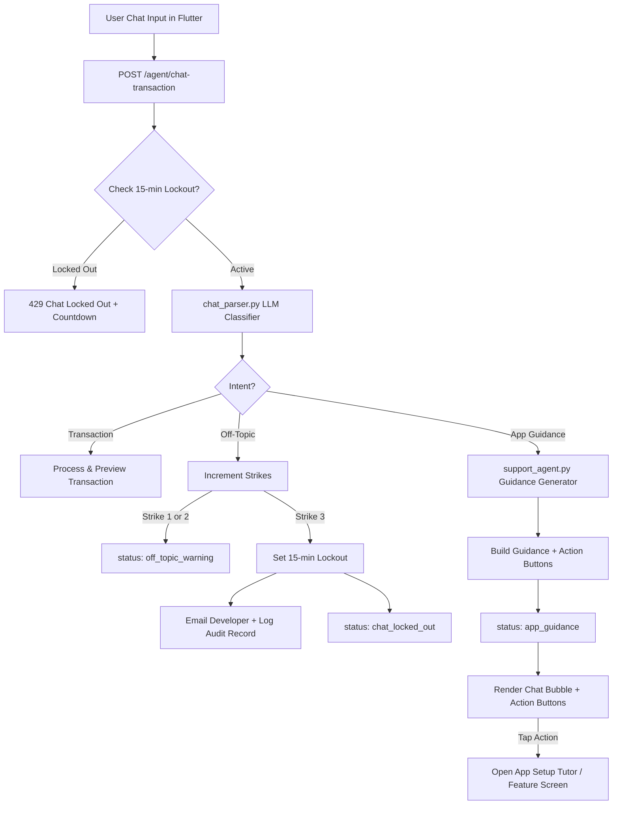

# Design Document: AI Chat Scoping, Anti-Chit-Chat Guardrails, In-Chat App Guide & Interactive Setup Tutor

**Date**: 2026-10-26  
**Status**: Approved  
**Scope**: `ai_service` & `flutter_app`

---

## 1. Executive Summary

This architecture establishes strict domain guardrails on the AI conversational interface, integrates real-time app guidance and action navigation into chat responses, and remakes the onboarding guide into an actionable 5-stage Setup Tutor.

1. **AI Chat Intent Scoping & Anti-Chit-Chat Guardrails**:
   - Classifies user chat messages into `transaction`, `simulation_or_app_help`, or `off_topic`.
   - Off-topic queries trigger a 3-strike warning system leading to a 15-minute chat lockout.
   - Strike 3 incidents record the user ID, email, timestamp, and query history, and send an alert email to the developer (`fmscoinfo@fmsco.com.sa`) for monitoring and account restrictions.
2. **In-Chat App Explanations & Quick Action Navigation**:
   - Detects when the user asks questions about using or setting up the app (e.g. *"كيف أسوي ميزانية؟"*, *"What is Nafaqah?"*).
   - Generates contextual, warm, professional Saudi-tailored explanations via `support_agent`.
   - Returns actionable navigation descriptors that render interactive buttons directly under the chat bubble (e.g. `[🚀 Launch Setup Tutor]`, `[📅 Set Payday]`, `[📊 Manage Envelopes]`).
3. **Interactive 5-Stage App Setup Tutor**:
   - Remakes `UserGuideWalkthroughDialog` into a step-by-step interactive setup wizard.
   - Forcefully shown on first-run onboarding and accessible anytime in Settings.
   - Walks through:
     1. Payday Cycle & Liquid Operating Cash
     2. Operating Accounts vs. Protected Savings Vaults
     3. Envelope Budgeting & Mid-Cycle Joining
     4. Living Model (Family Nafaqah vs. Roommates)
     5. 3 Frictionless Recording Methods (ZATCA QR, Voice/AI Chat, Manual Sheet)

---

## 2. Architecture & Subsystems



---

## 3. Subsystem 1: AI Chat Intent Classification & Cooldown Enforcement

### 3.1 Intent Classification Schema
In `ai_service/chat_parser.py`, the system prompt and parser model classify message intent:
- **`transaction`**: Financial expense logging, multi-item receipt breakdown, voice note transcription.
- **`simulation_or_app_help`**: Budget simulation (*"Can I buy a 1200 SAR iPad?"*) OR questions about using/setting up Budget Tracker (*"كيف أضيف حساب بنكي؟"*, *"How do salary cycles work?"*).
- **`off_topic`**: General conversation, poetry, coding assistance, weather, sports, or random banter unrelated to personal finance or Budget Tracker.

### 3.2 Strike Tracker & Cooldown Engine
Using `SlidingWindowRateLimiter` / Redis (keyed by `f"chat_offtopic:{user_id}"`):
- Strike counts persist over a 1-hour rolling window.
- **Strike 1 & 2**:
  - API returns HTTP 200 with `status: "off_topic_warning"`, `strikes: N`, `max_strikes: 3`.
  - Localized warning message advising the user that AI chat is dedicated strictly to expense recording and app support.
- **Strike 3**:
  - Sets a 15-minute lock on `f"chat_lockout:{user_id}"` with TTL = 900 seconds.
  - API returns HTTP 429 with:
    ```json
    {
      "detail": {
        "code": "chat_locked_out",
        "retry_after_seconds": 900,
        "message": "Chat is temporarily locked for 15 minutes due to repeated off-topic messages."
      }
    }
    ```
- **Flutter UI Handling**:
  - `ChatEntryScreen` catches `chat_locked_out` and disables the text input & mic button.
  - Displays a banner with a live countdown timer (`14:59`, `14:58`...).
  - Manual expense entry and camera receipt scanning remain completely unaffected and accessible.

### 3.3 Developer Violation Logging & Email Alert
When Strike 3 is reached:
1. An audit record is stored in `security_audit_logs` table (or security log) with:
   - `user_id`: Authenticated user UUID.
   - `user_email`: Verified email from Supabase JWT claims.
   - `household_id`: Active household UUID.
   - `timestamp`: UTC ISO-8601.
   - `offending_messages`: List of the 3 off-topic user messages.
   - `lockout_duration_seconds`: 900.
2. An alert email is dispatched via `mail_service` to `SUPPORT_EMAIL = "fmscoinfo@fmsco.com.sa"`:
   - **Subject**: `[Budget Tracker Security] AI Chat Lockout - User {email}`
   - **Body**: Detailed audit trail for developer review and monetization tiering.

---

## 4. Subsystem 2: In-Chat App Guidance & Quick Action Buttons

### 4.1 Guidance Generation in `chat_parser.py`
When intent is identified as `app_guidance`:
- Extracts the underlying user topic (e.g. `payday`, `budget`, `accounts`, `nafaqah`, `general`).
- Calls `support_agent.handle_support_query` with active household parameters (`payday_day`, `household_type`, `language`).
- Appends relevant action descriptors to the payload:
  - `open_tutor`: `[🚀 Launch Setup Tutor]`
  - `open_payday`: `[📅 Payday Settings]`
  - `open_budgets`: `[📊 Manage Envelopes]`
  - `open_accounts`: `[💳 Add Bank / Savings Vault]`
  - `open_roles`: `[👥 Household Roles]`

### 4.2 Flutter In-Chat Action Rendering
In `flutter_app/lib/screens/chat/chat_entry_screen.dart`:
- When message status is `app_guidance`:
  - Renders the assistant's reply bubble.
  - Directly beneath the bubble, renders a `Wrap` of action pills with theme-aware styling:
    - Primary highlight: `VelvetBurgundyColors.primaryLight` / `electricTeal`.
    - Distinct icons for each target feature.
  - Tapping an action button performs direct navigation:
    - `open_tutor` -> calls `UserGuideWalkthroughDialog.show(context)`.
    - `open_budgets` -> pushes `BudgetManagementScreen()`.
    - `open_accounts` -> pushes `AccountsOverviewScreen(householdId: hid)`.
    - `open_payday` / `open_roles` -> opens relevant modal dialog or settings sheet.

---

## 5. Subsystem 3: Interactive 5-Stage App Setup Tutor

### 5.1 Onboarding Lifecycle & Settings Access
- **First-Run Launch**:
  - In `DashboardScreen`, `UserGuideWalkthroughDialog.showIfFirstTime(context)` is replaced with `AppSetupTutorDialog.showIfFirstTime(context)`.
  - Checks SharedPreferences `has_seen_setup_tutor_v2`. If not seen, displays automatically on first load.
- **Settings Access**:
  - In `flutter_app/lib/screens/settings/settings_screen.dart` and `help_support_screen.dart`:
  - Prominent menu item: `[📖 App Setup Guide & Tutor]`.

### 5.2 The 5 Setup Stages
1. **Stage 1: Payday Cycle & Liquid Cash Starting Point**
   - *Explains*: The monthly cycle starting on the household payday (e.g. 27th) and live bank cash as the single source of truth.
   - *Action Button*: `[📅 Set Payday & Salary]` -> Opens Payday & Monthly Income sheet.
2. **Stage 2: Operating Accounts vs. Protected Savings Vaults**
   - *Explains*: Active operating accounts (Checking, STC Pay, Cash) fund monthly envelopes. Long-term buffers and emergency funds are ring-fenced in `Savings` accounts and never counted as spendable money.
   - *Action Button*: `[💳 Set Up Bank & Savings]` -> Opens `AccountsOverviewScreen`.
3. **Stage 3: Envelope Budgeting & Mid-Cycle Joining**
   - *Explains*: Fixed commitments (Rent, Utilities) vs Variable envelopes (Groceries, Dining). Details how mid-cycle joiners log prior spending with one tap to align with remaining cash without shrinking next month's budget.
   - *Action Button*: `[📊 Configure Envelopes]` -> Opens `BudgetManagementScreen`.
4. **Stage 4: Living Model (Islamic Nafaqah vs. Roommate Split)**
   - *Explains*:
     - *Family*: Islamic Nafaqah principles (husband provides, zero spousal % splits, wife reimbursement ledger, personal allowance).
     - *Roommates*: Peer-to-peer equal split and simplified multi-roommate debt settlement.
   - *Action Button*: `[👥 Configure Household Mode]` -> Opens `HouseholdRolesCard`.
5. **Stage 5: 3 Frictionless Recording Methods**
   - *Explains*:
     1. Saudi ZATCA Phase 2 QR & receipt scanner (automatic itemization).
     2. AI Voice & natural text logging (e.g. *"Starbucks 28 SAR coffee"*).
     3. Quick manual sheet with zero-overdraft balance protection.
   - *Action Button*: `[🚀 Finish & Start Tracking]` -> Saves completion in SharedPreferences and returns to Dashboard.

---

## 6. Localization (Trilingual Completeness)

All new user-facing strings are strictly added to `app_localizations.dart` in Arabic, English, and Urdu:
- `chat_offtopic_warning`: Strike warning message.
- `chat_locked_out_banner`: Lockout countdown message.
- `chat_action_open_tutor`: "Launch Setup Tutor" / "بدء جولة الإعداد" / "سیٹ اپ ٹیوٹر شروع کریں"
- `chat_action_open_payday`: "Payday Settings" / "إعدادات يوم الراتب" / "تنخواہ کی ترتیبات"
- `chat_action_open_budgets`: "Manage Envelopes" / "إدارة الميزانيات" / "بجٹ کا انتظام کریں"
- `chat_action_open_accounts`: "Add Bank / Savings" / "إضافة حساب / ادخار" / "بینک / بچت کھاتہ شامل کریں"
- `chat_action_open_roles`: "Household Mode" / "نظام السكن" / "گھریلو نظام"
- `tutor_stage_1_title` through `tutor_stage_5_desc`: Full rich descriptions for all 5 setup stages.

---

## 7. Quality & Verification Gates

1. **Python Unit & Integration Tests**:
   - `tests/test_chat_scoping.py`: Verify classification of off-topic messages, strike accumulation, 15-minute lockout header, and developer email trigger.
   - `tests/test_chat_app_guidance.py`: Verify app questions return `status: "app_guidance"` with structured actions.
2. **Flutter Widget & Integration Tests**:
   - `test/widgets/chat_lockout_test.dart`: Verify lockout countdown banner and input disabling.
   - `test/widgets/chat_guidance_actions_test.dart`: Verify action buttons render and execute navigation callbacks.
   - `test/widgets/app_setup_tutor_dialog_test.dart`: Verify 5-stage setup sequence, action buttons, and SharedPreferences persistence.
3. **Guardrails**:
   - Zero `flutter analyze` issues.
   - `test/ui_l10n_guard_test.dart` passes (zero hardcoded strings).
   - Full test suites green (`flutter test` & `pytest -v`).
