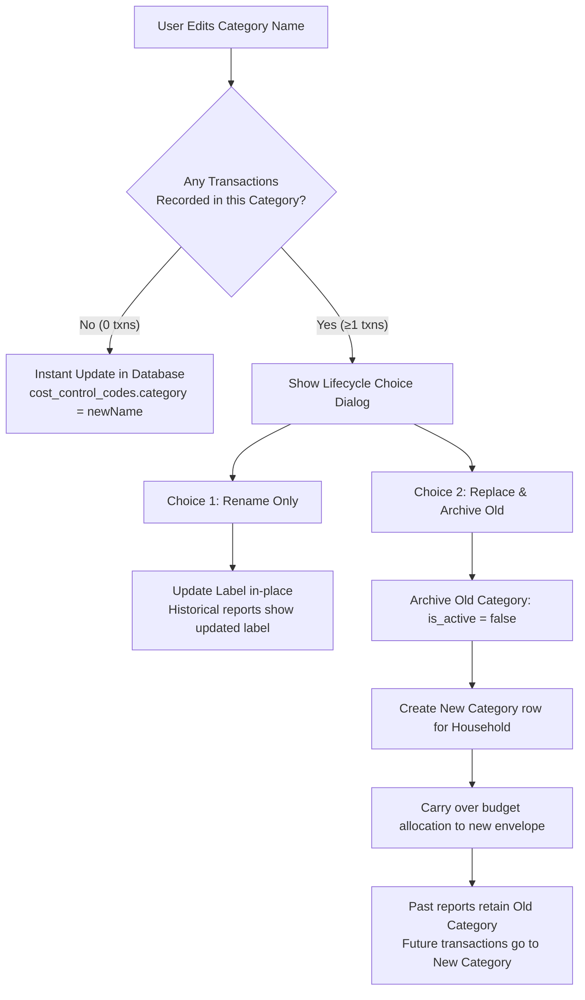

# Household Autonomous Budgets, Sub-Budgets & Category Lifecycle Design

- **Date:** 2026-10-26
- **Status:** Proposed (Under Review)
- **Author:** Lead Architect & Agentic AI Pair
- **Branch:** `feat/ai-chat-guardrails-and-setup-tutor`

---

## 1. Executive Summary

### 1.1 Problem Statement
In the original architecture, default expense categories (`cost_control_codes`) and sub-categories (`cost_control_sub_categories`) were shared, global reference rows (`household_id = NULL`, `is_system = true`). This caused two critical product issues:
1. **Lack of Household Autonomy:** A household could not rename default categories (such as *Fuel* or *Groceries*) or manage standard sub-budgets without being blocked by Row-Level Security (RLS) or backend API refusals (`SUB_CATEGORY_FORBIDDEN` 403).
2. **Historical Report Corruption Risk:** If a user were allowed to blindly mutate an existing category row from `"Groceries"` to `"Electronics"`, months of past grocery transactions would retroactively appear as electronics, corrupting historical spending trends, burn rates, and financial reports.

### 1.2 Proposed Solution
Transform budget envelopes and sub-budgets into a **fully autonomous, household-scoped system**:
1. **Preloaded Starter Catalog:** Every new household receives a rich, culturally tailored starter kit of categories and sub-categories (Saudi household defaults) that they own 100%.
2. **Smart Category Lifecycle (Ledger Immutability):**
   - If a category has **0 past transactions**: Instant direct edit/rename.
   - If a category has **≥1 past transactions**: The app detects historical data and presents a 2-option choice:
     - **"Rename Only"**: Updates display label across past & future records (e.g., translation, vernacular phrasing like *"Fuel"* → *"بنزين ومشاوير"*).
     - **"Replace & Archive Old"**: Deactivates/archives the old category (preserving historical records and past monthly reports) and provisions the new category as a fresh active budget envelope.
3. **Dynamic AI & ZATCA Scanner Categorization:** The AI classifier and receipt parser match merchants against the household's *current active categories*, ensuring that merchants like Panda are never misclassified into repurposed categories (like *Electronics* or *Vacation*).

---

## 2. Architecture & Data Model

### 2.1 Database Schema Evolution (Supabase / PostgreSQL)

```
┌─────────────────────────────────────────────────────────────────┐
│                      cost_control_templates                     │
│  (System Read-Only Master Seed for New Households & Suggestions)│
├─────────────────────────────────────────────────────────────────┤
│  code: VARCHAR(60) PK (e.g. 'OPEX-GROCERY')                     │
│  default_name_en: VARCHAR(100)                                  │
│  default_name_ar: VARCHAR(100)                                  │
│  icon_key: VARCHAR(50)                                          │
│  keywords: TEXT[]                                               │
└────────────────────────────────┬────────────────────────────────┘
                                 │
                 cloned on household creation
                                 ▼
┌─────────────────────────────────────────────────────────────────┐
│                       cost_control_codes                        │
│                 (Owned 100% by Household)                       │
├─────────────────────────────────────────────────────────────────┤
│  id: UUID PK DEFAULT gen_random_uuid()                          │
│  household_id: UUID NOT NULL REFERENCES households(id)          │
│  code: VARCHAR(80) NOT NULL                                     │
│  category: VARCHAR(100) NOT NULL (User editable display name)   │
│  icon_key: VARCHAR(50)                                          │
│  is_system: BOOLEAN DEFAULT false                               │
│  created_at: TIMESTAMPTZ DEFAULT now()                          │
│  CONSTRAINT uq_hh_code UNIQUE (household_id, code)              │
└────────────────────────────────┬────────────────────────────────┘
                                 │
                                 ├────────────────────────┐
                                 ▼                        ▼
┌───────────────────────────────────────────┐  ┌──────────────────────────────────┐
│        cost_control_sub_categories        │  │             budgets              │
├───────────────────────────────────────────┤  ├──────────────────────────────────┤
│ id: UUID PK DEFAULT gen_random_uuid()     │  │ id: UUID PK                      │
│ household_id: UUID NOT NULL               │  │ household_id: UUID NOT NULL      │
│ parent_code: VARCHAR(80) NOT NULL         │  │ category_code: VARCHAR(80)       │
│ sub_code: VARCHAR(80) NOT NULL            │  │ cycle_key: VARCHAR(10) NOT NULL  │
│ name_en: VARCHAR(100) NOT NULL            │  │ allocated_amount: NUMERIC(12, 2) │
│ name_ar: VARCHAR(100)                     │  │ sub_allocations: JSONB           │
│ is_active: BOOLEAN DEFAULT true           │  │ is_active: BOOLEAN DEFAULT true  │
│ CONSTRAINT uq_hh_sub UNIQUE (hh, parent,  │  └──────────────────────────────────┘
│                              sub_code)    │
└───────────────────────────────────────────┘
```

### 2.2 Row-Level Security (RLS) Policies
* **`cost_control_codes`:**
  - `SELECT`: `USING (household_id IN (SELECT household_id FROM household_members WHERE user_id = auth.uid()))`
  - `INSERT`: `WITH CHECK (household_id IN (SELECT household_id FROM household_members WHERE user_id = auth.uid() AND role IN ('admin', 'co_admin')))`
  - `UPDATE`: `USING (household_id IN (SELECT household_id FROM household_members WHERE user_id = auth.uid() AND role IN ('admin', 'co_admin')))`
  - `DELETE`: Disallowed directly; deactivation via `is_active = false` or `household_category_settings` preserves foreign key constraints from `transactions`.

* **`cost_control_sub_categories`:**
  - Full CRUD scoped to the household admin:
    `USING (household_id IN (SELECT household_id FROM household_members WHERE user_id = auth.uid() AND role IN ('admin', 'co_admin')))`

---

## 3. Category Lifecycle & Ledger Immutability

### 3.1 The Two-Track Update Flow

When a user taps **"Rename Category"** or edits a category in the Budget Management Screen:



### 3.2 Detailed Choice Specifications

#### Choice 1: Rename Only (Refinement)
* **Use Case:** Fixing a typo, translating to Arabic, or tailoring the phrasing (e.g., *"Fuel"* → *"بنزين ومشاوير"*).
* **Action:** Direct update of `cost_control_codes.category`.
* **Effect:** Past and future transactions reflect the new title. The underlying `code` and transaction links remain unchanged.

#### Choice 2: Replace & Archive Old (Repurposing)
* **Use Case:** Changing purpose (e.g., *"Groceries"* → *"Electronics"* or *"Vacations"*).
* **Action:**
  1. Call RPC `replace_household_category(p_household_id, p_old_code, p_new_name, p_new_code, p_cycle_key)`:
     - Old category is marked inactive in `household_category_settings` (`is_active = false`).
     - Old budget envelope for the current cycle is closed.
     - New category is inserted into `cost_control_codes` with `household_id = p_household_id`.
     - New budget envelope is created for the active salary cycle.
  2. Transaction history remains bound to `p_old_code`.
* **Result:** Historical analytics (e.g., July supermarket spending) remain accurately labeled as *"Groceries"*. Future transactions and receipt scans log under *"Electronics"*.

---

## 4. ZATCA & AI Dynamic Expense Classification

### 4.1 ZATCA Phase-2 QR Ingestion
Saudi ZATCA e-invoicing QR codes contain TLV base64 tags:
1. Tag 1: Seller Name
2. Tag 2: VAT Registration Number
3. Tag 3: Timestamp
4. Tag 4: Total Amount (with 15% VAT)
5. Tag 5: VAT Amount

**There is no category code in the QR code.** The app uses the **Seller Name** (`seller`) for category attribution.

### 4.2 Dynamic Household-Scoped Classification
In `ai_service/receipt_scanner.py` and `ai_service/chat_parser.py`:
1. The classifier fetches the **active categories and sub-categories of the caller's household**:
   ```python
   active_categories = get_active_categories_for_household(household_id)
   # e.g. [{'code': 'CUSTOM-ELEC', 'name': 'Electronics', 'keywords': ['jarir', 'extra', 'laptop']}]
   ```
2. The AI matches the merchant against this active list:
   - If *Panda* is scanned:
     - If the household has an active *"Groceries"* or *"مقاضي"* category, it maps to it.
     - If the household archived groceries and replaced it with *"Electronics"*, the AI will **never** assign Panda to *"Electronics"*. It suggests *"Uncategorized / General"* and asks the user to pick an envelope.
   - If *Jarir Bookstore* is scanned:
     - The AI matches it to *"Electronics"*.
3. **Confirmation Screen:** The receipt review sheet always allows the user to tap and change the category before final recording.

---

## 5. UI/UX Specifications (Flutter Mobile)

### 5.1 Budget Management Screen Enhancements
1. **Tune Icon (`Icons.tune_rounded`):** Clearly dedicated to adjusting envelope budget amounts.
2. **Category 3-Dots Menu (`⋮`):**
   - **Rename / Customize Category:** Opens the lifecycle dialog.
   - **Manage Sub-Budgets:** Opens the full sub-budget manager.
   - **Deactivate / Hide Envelope:** Hides the envelope from active tracking without losing historical data.
3. **Full Sub-Budget Management:**
   - Any envelope can have custom sub-categories added, renamed, or deleted.
   - Deleted sub-categories with past spend are softly archived (`is_active = false`).

### 5.2 Trilingual Support
All labels, dialog prompts, and explanatory text are fully translated across:
- **Arabic (Primary):** *"تعديل اسم التصنيف"*, *"استبدال وأرشفة القديم"*, *"تحديث الاسم فقط"*.
- **English:** *"Update Category"*, *"Replace & Archive Old"*, *"Rename Only"*.
- **Urdu:** *"کیٹیگری تبدیل کریں"*, *"پرانی محفوظ کر کے نئی بنائیں"*, *"صرف نام تبدیل کریں"*.

---

## 6. Implementation Stages & Verification

1. **Stage 1: Supabase Migration**
   - Add `household_id` support to `cost_control_sub_categories`.
   - Create `seed_household_default_taxonomy(household_id)` database function.
   - Add `replace_household_category` RPC for atomic lifecycle replacement.
   - Update RLS policies to allow household admins full CRUD.

2. **Stage 2: AI Service Microservice Updates (`ai_service`)**
   - Update `get_household_categories` and `match_category` to match against household-specific dynamic categories and keywords.
   - Remove global `is_system` blocks in subcategory routes.

3. **Stage 3: Flutter UI Implementation**
   - Implement the `CategoryLifecycleDialog` (checking transaction counts and providing the two-track choice).
   - Update `SubBudgetAllocationDialog` to allow adding, renaming, and removing any sub-budget.

4. **Stage 4: Automated Testing & Verification**
   - Unit tests for the RPC and lifecycle choices.
   - Widget tests for the lifecycle dialog in English, Arabic, and Urdu.
   - Full regression suite execution (`flutter test` + `flutter analyze`).
